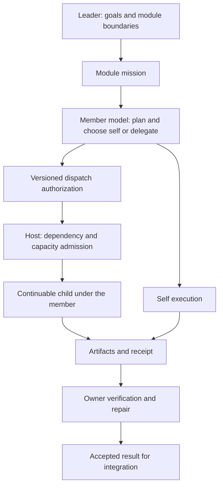

# Architecture

[README](../README.en.md) · [Configuration](CONFIGURATION.md) · [Acceptance](ACCEPTANCE.md)

Team Workbench is a native DSH bundle with a Host plugin and a web client contribution. It uses injected DSH services and native Session/UI facilities rather than patching the application archive or embedding a separate chat application.

## 1. Components

| Area | Source | Responsibility |
| --- | --- | --- |
| Bundle entry | `index.js`, `cordis.patch.yml` | Activate the plugin and declare profile configuration changes. |
| Host assembly | `src/host/index.js`, `adapter.js`, `config.js` | Inject native services, normalize configuration, register disposable capabilities. |
| Team domain | `service.js`, `autonomy.js`, `identity.js` | Members, missions, plans, work, ownership, authorization, and provenance. |
| Scheduling | `scheduler.js`, `constraints.js` | Event wakeups, ready selection, capacity, and dispatch. |
| Persistence | `storage.js`, `storage-fallback.js`, `remediationStorage.js` | Durable records, revisions, fallback storage, and single-writer behavior. |
| Evidence | `execution.js`, `evidence.js`, `findings.js`, `materialize.js` | Recorded checks, artifact hashes, acceptance evidence, and mechanical file operations. |
| Context and usage | `contextControl.js`, `nativeUsage.js`, `usage.js`, `fingerprints.js` | Compact state, native usage accounting, price estimates, and error history. |
| Model tools and HTTP | `tools.js`, `web.js` | Runtime-checked model operations and compact read-only projections. |
| Client | `src/client/`, generated `client.js` | Pane layout, native conversation rendering, child navigation, member details, and status views. |
| Compatibility | `src/compat/01-focus-bridge.js` | Focus and native right-sidebar integration. |

## 2. Responsibility and execution

### 2.1 Identity

The native runtime identifies the actual calling Agent and Team membership. Provenance records capture that identity. Client-supplied names and model-supplied approval fields cannot establish who planned or authorized work.

The native Team roster and workbench's persistent records are related but distinct. Recovery must reconcile their identities; a row in the workbench database does not create a live native parent Agent.

### 2.2 Missions and plans

A leader's mission contains a module goal, boundaries, input references, budget, and acceptance criteria. It is not runnable leaf work.

The owning member submits a versioned plan with independently usable deliverables. A deliverable can use member self-execution or delegation. Plan changes use revision checks. A persistent deliverable identity helps prevent renaming the same unfinished output into successive stage tasks.

### 2.3 Dispatch

The member authorizes delegation for a matching plan revision. The scheduler consumes authorized intents; it does not use the raw mission as permission to generate leaf tasks itself. An owner field on leader-created work is not equivalent to member authorization.

Reservation records the attempt, authorization relationship, and capacity before the native start. Native startup takes place outside the state lock. Short parallel start calls are different from waiting for every child in a batch to finish.

### 2.4 Completion

An executor's report records what was produced. The owner checks artifacts against acceptance criteria, with execution records and artifact freshness where required. Produced and accepted remain distinct. An idle model, a timeout, or a nonempty completion file cannot establish success.

Executable verification is evidence of the declared command's observed result. It does not prove unobserved real-model or desktop behavior. Each acceptance claim must retain its scope.

### 2.5 Capacity

Account for native resident activations, executing leaves, and provider constraints separately. A member waiting for children may still consume resident capacity. The default resident allowance is `40 - 3 - 2 = 35`; five members plus 30 leaves consume this example allowance.

Fair-share settings can lend idle capacity. Dependencies, write conflicts, attempt budgets, native pool rejection, and configured provider constraints can all prevent admission. A configured capacity is not a measured throughput promise.

## 3. Events and recovery

Work changes and native lifecycle events wake the scheduler. Ready work can fill a freed slot while unrelated slow work is still running. Admission never requires that an entire batch finish.

Persistent intents and execution records make incomplete starts and late receipts inspectable. The native journal and plugin records are not one atomic transaction; recovery therefore uses reconciliation and idempotency rather than assuming both writes always succeed together.

Recovery must preserve completed work, prevent duplicate active execution, and establish real parent availability before child operations. Unexpected missing native state should produce a precise reason rather than a fabricated live Agent.

Single-writer protection limits concurrent mutations against one data root. This is a local runtime design, not a distributed multi-Host scheduler.

## 4. UI and read paths

The main panel creates separate session-scoped pane content and reuses native conversations. Direct pane bindings are workspace main sessions. Member and leaf navigation happens inside a bound session through child-session addresses.

Conversation editor instances, focused session, right-sidebar state, and approvals require careful scoping. Removing a rendered view does not itself mean cancelling background work. Compatibility changes need live UI validation against the installed DSH version.

`GET /state` provides compact projections. Long lists use paginated detail reads. Read-only dashboard access must not start models, authorize work, wake members, or alter business state. A frontend revision announcement alone does not prove that the new bundle rendered; the client records its mounted revision separately.

## 5. Boundaries

- DSH 0.2.0-rc.2 is the investigated interface baseline; newer interfaces need review.
- Native Team and a continuable provider are required for team execution. Optional-service injection supports diagnostics when dependencies are missing, not full functionality without them.
- Write-scope coordination applies to managed work; it is not filesystem isolation from unrelated tools or external processes.
- Host command roots and declared arguments are execution checks, not an operating-system sandbox.
- Usage is derived from available records; missing records and prices remain unknown. Estimates are not provider invoices.
- External workflow skills are optional. Public defaults do not import or route into a private skill package.
- Source-level and simulated-interface checks are separate from real DSH, real model, reload, restart, and user-experience acceptance.
